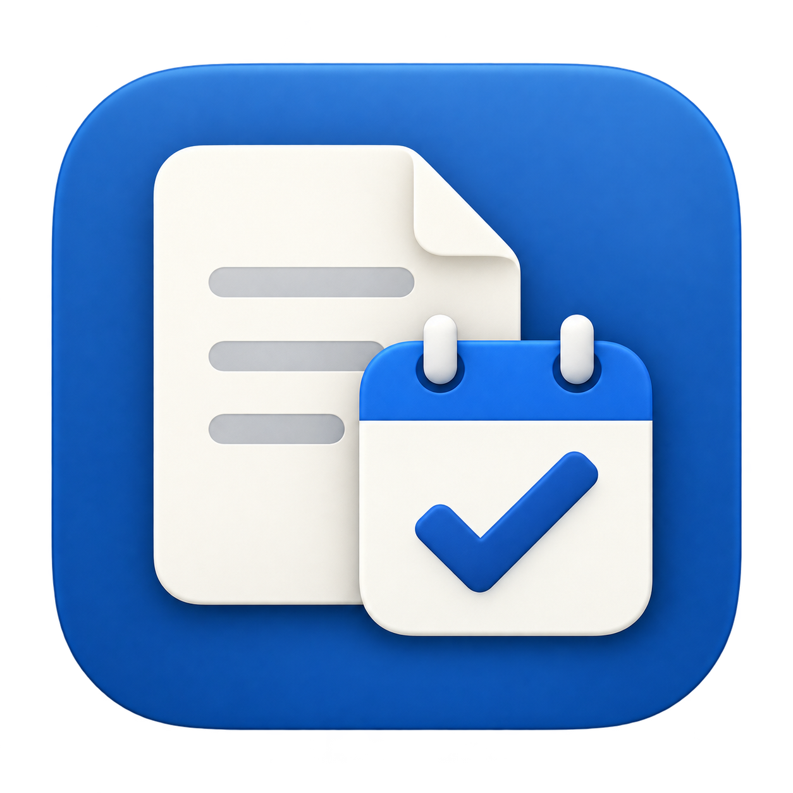
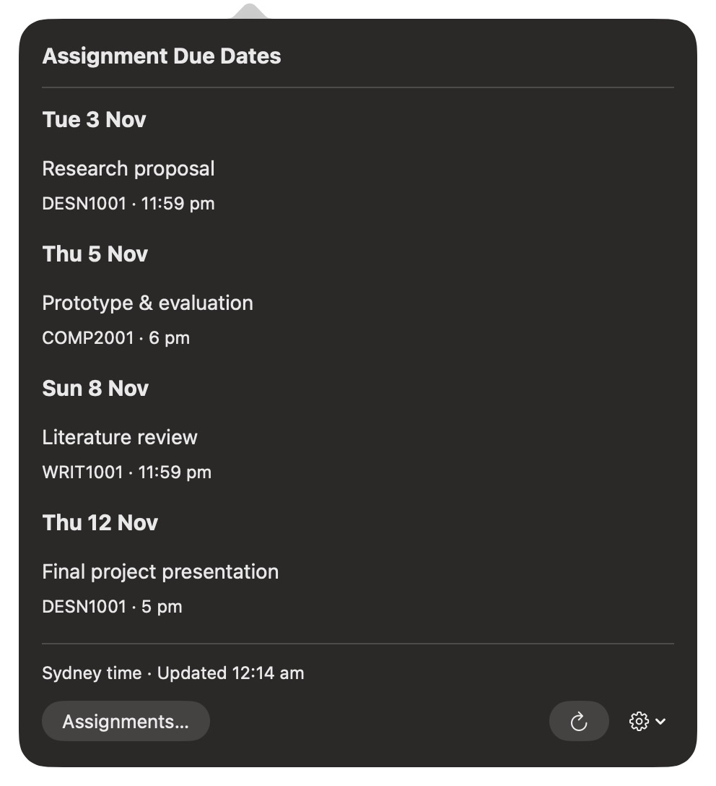
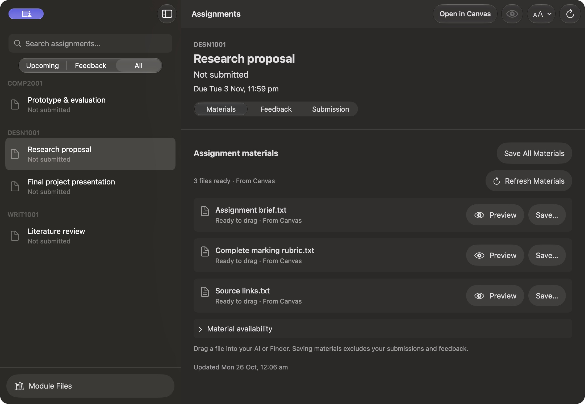

<p align="center"></p>

# When the F*ck Are My Assignments Due?

**A Canvas assignment tracker and course-materials app for macOS.** For University of Sydney students who would rather spend less time navigating Canvas and more time doing literally anything else.

Assignment Dates puts Canvas assignment due dates in your Mac menu bar, and brings assignment briefs, marking rubrics, released marks, lecturer feedback, and course files together in one place. It can collect Canvas module files for download and prepare materials for you to share with an AI tool of your choice. It does not submit coursework or send your content to an AI service.

This app began with one extremely reasonable question:

> “When the f*ck are my assignments due?”

A date. A time. Ideally, some notice before both become the past.

Your next Canvas assignment deadline lives in the Mac menu bar. Click for the rest of the damage.

<p align="center"></p>

Then the questions escalated.

## Canvas assignment briefs, rubrics, and feedback: “How the f*ck do I find the important stuff quickly?”

The brief. The rubric. The feedback. That PDF your lecturer mentioned once, three weeks ago.

Bring them together on the assignment page. Search your subjects, see what’s coming up, and spend less time opening tabs called “Assessment information (updated) FINAL”.

<p align="center"></p>

## Download Canvas module files and course materials

One week. All weeks. Straight to Downloads.

Keep the module folders, grab the original PDFs and spreadsheets, and get on with it. Preview a file, save a module's materials, or drag a ready copy into another app.

Your mouse has suffered enough.

## Share assignment materials with your AI tool, on your terms

“Can I get all my course stuff into AI for my assignments?”

Get the requirements and teaching materials together, then take the files to your AI of choice.

So your first fifteen messages can stop being:

> “Wait, there’s another PDF.”
>
> “And the rubric.”
>
> “Actually, that was last week’s rubric.”

Copy a complete rubric. Bring along feedback from a previous assessment when you need it. You choose what to share and where it goes.

<sub>Sample coursework shown.</sub>

## Frequently asked questions

### What is Assignment Dates?

Assignment Dates is a native macOS menu bar app for viewing Canvas assignment deadlines, course materials, module files, released marks, and assignment feedback in one place.

### Which Canvas LMS does it work with?

It is configured for the University of Sydney's Canvas site (`canvas.sydney.edu.au`). It is not currently a general-purpose app for Canvas accounts at other institutions.

### Can it submit assignments or change anything in Canvas?

No. Assignment Dates reads Canvas course and assignment information and downloads files you choose. It does not upload or submit coursework.

### Does it send my course content to an AI service?

No. The app does not automatically send content to an AI service. You choose whether to copy or share assignment requirements, rubrics, feedback, and files with another app.

### What does it need to run?

An Apple Silicon Mac running macOS 27, plus a University of Sydney Canvas access token. The app is built with Xcode and the macOS 27 SDK.

## Build it

Apple Silicon · macOS 27 · Xcode with the macOS 27 SDK · University of Sydney Canvas.

```sh
./build.sh
open 'dist/Assignment Dates.app'
```

Add your Canvas access token in **Settings → Update API key…**, then click the menu bar countdown to get started.
